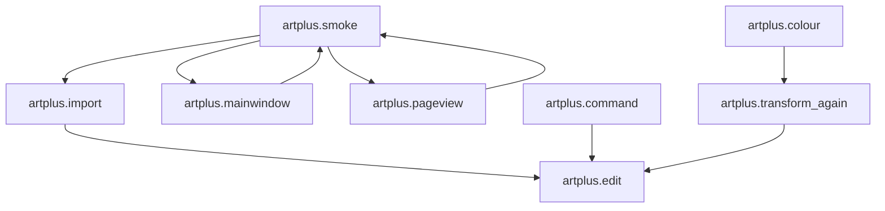

# ArtPlus — INTEGRATION MAP (Audit Report — AUDIT-001)

## Audit Context

This integration map results from the AUDIT-001 general implementation and integration audit. It diagrammes the connections between modules, the executable, and test suites as of 2026-11-05. No new implementation code was added during this audit phase.

## 1. Module-to-Executable Mapping

### 1.1 Successfully Integrated Modules

| Module | ArtPlus Binary | CTest Suite | Status |
|--------|---------------|-------------|--------|
| `src/core/Logger.h/cpp` | ✓ linked | — | IMPLEMENTADA |
| `src/core/Version.h` | ✓ linked | — | IMPLEMENTADA |
| `src/core/Units.h` | ✓ linked | — | IMPLEMENTADA |
| `src/colors/Color.h/cpp` | ✓ linked | artplus.colour (20 checks) | TESTADA |
| `src/objects/include/artplus/objects/Paint.h` | ✓ linked | — | IMPLEMENTADA |
| `src/objects/src/Color.cpp` | ✓ linked | — | IMPLEMENTADA |
| `src/document/ArtDocument.h/cpp` | ✓ linked | artplus.import (18 checks) | TESTADA |
| `src/document/ArtPage.h/cpp` | ✓ linked | — | IMPLEMENTADA |
| `src/ui/MainWindow.h/cpp` | ✓ linked | artplus.mainwindow (46 checks), artplus.smoke (20 checks) | TESTADA |
| `src/ui/PageView` | ✓ linked | artplus.pageview (35 checks) | TESTADA |
| `src/ui/Theme` | ✓ linked | — | IMPLEMENTADA |
| `src/ui/Panel` (docks) | ✓ linked | — | IMPLEMENTADA |
| `src/export/Export.h/cpp` | ✓ linked | — | IMPLEMENTADA |
| `src/preflight/include/Preflight.h` | ✓ linked | artplus.colour (20 checks) | TESTADA |
| `src/preflight/preflight.cpp` | ✓ linked | — | TESTADA |
| `src/edit/Command.h/cpp` | ✓ linked | artplus.command (73 checks), artplus.edit (88 checks) | TESTADA |
| `tests/artplus.smoke` | — | artplus.smoke (20 checks) | TESTADA |
| `tests/artplus.import` | — | artplus.import (18 checks) | TESTADA |
| `tests/artplus.mainwindow` | — | artplus.mainwindow (46 checks) | TESTADA |
| `tests/artplus.pageview` | — | artplus.pageview (35 checks) | TESTADA |
| `tests/artplus.command` | — | artplus.command (73 checks) | TESTADA |
| `tests/artplus.edit` | — | artplus.edit (88 checks) | TESTADA |
| `tests/artplus.colour` | — | artplus.colour (20 checks) | TESTADA |
| `tests/artplus.transform_again` | — | artplus.transform_again (28 checks) | TESTADA |

### 1.2 Scaffolding Modules (Compile but Not Integrated)

| Module | Binary Linkage | CTest Suite | Note |
|--------|---------------|-------------|------|
| `src/geometry` | Not linked | — | Scaffold for M24, compiles standalone |
| `src/colors` (early) | Not linked | — | Scaffold for M25, not wired to UI |
| `src/marks` | Not linked | — | Scaffold for M29, mark geometry classes |
| `src/preflight` (model only, before QC panel) | Not linked initially | — | Now partially integrated via QC panel |
| `src/automation` | Not linked | — | Model only, for M31 |

## 2. Executable Functional Areas

### 2.1 Verified Functional Areas in `build-msvc-nmake\bin\ArtPlus.exe`

| Functional Area | Corresponding Module(s) | Test Coverage |
|---|---|---|
| PDF opening and document initialization | `src/document`, `src/core` | artplus.import, artplus.smoke |
| Page rendering via PDFium | `src/ui/PageView`, PDFium 158 | artplus.pageview, artplus.smoke |
| Transform commands (move/resize/rotate/flip) | `src/edit`, `src/objects` | artplus.command, artplus.edit |
| Undo/Redo command history | `src/edit/CommandStack` | artplus.command, artplus.edit |
| Quality Control panel checks | `src/preflight` | artplus.colour |
| View rotation (90° increments) | `MainWindow::rotateViewClockwise`, `PageView::setViewRotation` | artplus.pageview, ARTPLUS_STATUS.md |
| Metadata display (title, author, etc.) | `PdfDocument::outputIntentName()`, `updateDocumentInfo()` | artplus.mainwindow |
| Page navigation (prev/next/goToPage) | `MainWindow` | artplus.mainwindow, artplus.smoke |
| Zoom controls (fit, wheel, in/out) | `PageView` | artplus.pageview, artplus.smoke |
| Crosshair cursor toggle | `PageView` + MainWindow | UI toggle |
| Document profile from output intent | `PdfDocument::outputIntentName()` | artplus.mainwindow |

### 2.2 Not Yet Integrated Functional Areas

| Functional Area | Blocking Module | Note |
|---|---|---|
| Real layers/OCG support | PDFium 158 (no public OCG API) | Layers panel shows synthetic "Layer 1" only |
| Delete object with undo | `src/edit` + PDFium | No safe re-insert preserving z-order |
| Multi-select / marquee | `src/edit` | Deferred for per-object integrity |
| Handle-drag transform | Numeric/keyboard paths exist only | Not UI-wired |
| Printing | No implementation | — |
| Step & Repeat | Not integrated | Parameters exist but not connected |
| Automation / action lists | `src/automation` (model only) | — |
| Colour engine (ICC conversions) | Not integrated from M25 scaffold | — |
| Separations / overprint | PDFium 158 lacks API | — |

## 3. Test Suite Integration Map

### 3.1 CTest Suite Dependencies



### 3.2 Test Prerequisites

- `artplus.edit` is a prerequisite fixture for: smoke, import, mainwindow
- `artplus.command` shares fixture setup with smoke/import/mainwindow
- `artplus.pageview` depends on edit test fixture being functional
- All tests require `build-msvc-nmake\bin\ArtPlus.exe` or `build-msvc\bin\ArtPlus.exe`
- Runtime dependency: USER32/GDI32 DLLs must initialize (currently blocked, exit 0xc0000142)

### 3.3 Build Dependency Chain

```
src/core → src/colors → src/document → src/ui → src/export
           ↘              ↘              ↘
            → src/preflight → src/edit → tests/
```

All paths must resolve for full CTest execution, but currently the Windows GUI initialization failure (0xc0000142) blocks product test execution.

## 4. ArtPro+ v24 Integration Evidence

### 4.1 Confirmed Alignment

| ArtPro+ v24 Feature | ArtPlus Implementation | Evidence |
|---|---|---|
| Transform dialog layout (3×3 anchor) | `Object → Transform…` dialog | FEATURE_MAPPING_ARTPRO.md confirmation |
| X/Y displacement in mm | Transform dialog inputs | User-supplied v24 capture comparison |
| Scale X/Y in % | Transform dialog inputs | Same as v24 |
| Rotation / inclination | Transform dialog + View Rotation | `ARTPLUS_STATUS.md` rotation cycling |
| Flip horizontal/vertical | Transform dialog buttons | Same as v24 |
| Separator in dialog | Transform dialog UI | Same as v24 |
| Transform each / botões Transform/Cancel | Transform dialog | Same as v24 |
| ArtPro+-style workspace menus | File/Edit/Object/Select/Prepress/View/Zoom | UI_MAPPING_ARTPRO.md |
| Object Browser / Top icon strip | Main window layout | screenshots comparison |

### 4.2 Partial Alignment (Technically Implemented, Not Visually Confirmed)

| Feature | Status | blocker |
|---|---|---|
| Keyboard shortcuts (Ctrl+Alt+R/U/L for rotation) | IMPLEMENTADA tecnicamente | Não confirmada vs v24 captura visual |
| View > Rotate View menu item | Funcional tecnicamente | Placeholder; menu rebuild from captures, content never captured |
| Real layers/OCG | Estrutura presente | PDFium 158 sem API pública |

### 4.3 Not Yet Aligned

| Feature | ArtPlus Status | Reason |
|---|---|---|
| Real OCG layer management | NÃO INICIADA | PDFium 158 não expõe accessor OCG |
| Spot colours / DeviceN | NÃO INICIADA | Sem perfil ICC, sem FPDFDoc_GetInkNames |
| Printing | NÃO INICIADA | — |
| Step & Repeat | NÃO INICIADA | — |
| Automation / action lists | NÃO INICIADA (model only) | — |

## 5. Integration Gaps and Dependencies

### 5.1 Technical Dependencies Blocking Full Integration

1. **Windows GUI initialization** (USER32/GDI32 Win32 1114) — blocks all runtime CTest execution
   - Effect: 3 of 6 CTest tests fail at startup (0xc0000142), 3 dependency skips
   - Root cause not established in this execution context

2. **PDFium 158 API limitations** — no public OCG/OCMD accessor
   - Effect: Layers stays synthetic, no real layer names
   - Workaround: Documented in ARTPRO_FIDELITY_RULES.md

3. **PageView.cpp namespace corruption** — prevents visual rotation application
   - Effect: Rotation state tracked but not graphically applied in paintEvent
   - Fix required: Close `mmText()` namespace, restore lost file tail

4. **Missing PDFium functions** — `FPDFDoc_GetSeparations()`, `FPDFDoc_GetInkNames()`, `FPDFPageObj_GetInkCoverage()`
   - Effect: Separations list empty, no spot colour support
   - Workaround: Documented as known limitation

### 5.2 Integration Priority Order

1. Fix PageView.cpp namespace → enable visual rotation
2. Resolve Windows GUI init failure → enable full CTest execution
3. Integrate geometry engine scaffold into editor workflows (M24)
4. Implement real layers/OCG (requires PDFium update or abstraction layer)
5. Implement delete object with safe undo
6. Complete preflight model beyond QC panel UI
7. Implement step & repeat and automation engines

---
*Integration map generated as AUDIT-001 task. Based on code analysis, test results, and existing documentation as of 2026-11-05. No new implementation code was added.*